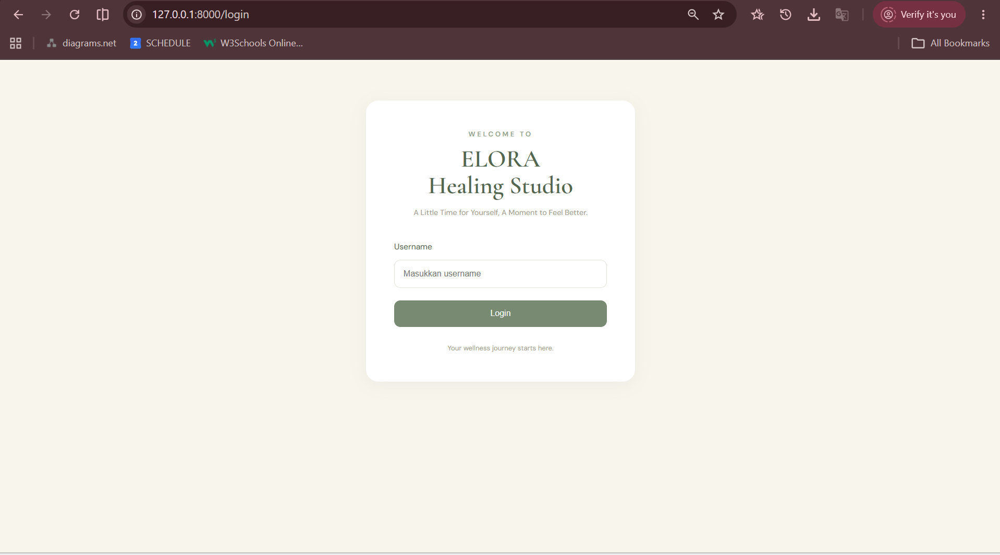
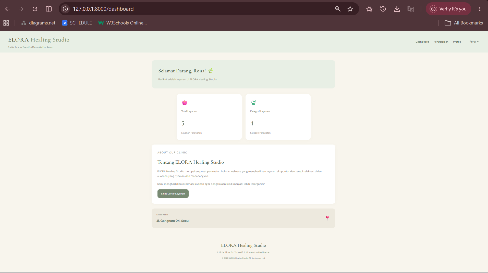
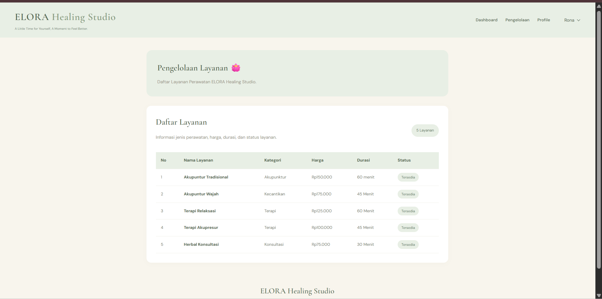
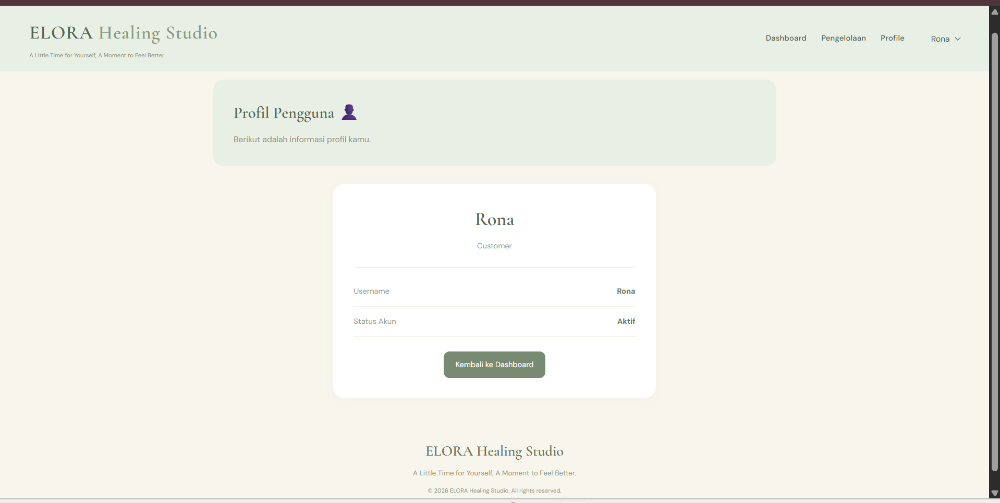

# ELORA Healing Studio 🌿

## Tentang Project

ELORA Healing Studio merupakan sebuah website sederhana yang dibuat untuk memenuhi tugas Ujian Tengah Semester (UTS) mata kuliah Pemrograman Web.

Website ini mengangkat tema *Holistic Wellness & Acupuncture Spa*, yaitu layanan wellness dan relaksasi yang berfokus pada terapi akupunktur.

Website ini dikembangkan menggunakan framework Laravel dengan tujuan untuk menampilkan informasi layanan yang tersedia serta memudahkan pengelolaan informasi layanan pada ELORA Healing Studio.

## Fitur Website

1. **Login**  
   Halaman untuk memasukkan username sebelum mengakses dashboard.

2. **Dashboard**  
   Menampilkan informasi ringkas mengenai jumlah layanan dan jumlah kategori layanan.

3. **Pengelolaan Layanan**  
   Menampilkan daftar layanan dalam bentuk tabel yang berisi nama layanan, kategori, harga, durasi, dan status layanan.

4. **Profile**  
   Menampilkan informasi pengguna, role, dan status akun.

5. **Logout**  
   Fitur untuk mengakhiri sesi pengguna dan kembali ke halaman login.

## Teknologi yang Digunakan

- PHP
- Laravel
- HTML
- CSS
- Blade Template

## Screenshot Website

### 1. Halaman Login

Halaman awal website yang digunakan pengguna untuk memasukkan username sebelum masuk ke dashboard.

### 2. Halaman Dashboard

Menampilkan ringkasan informasi mengenai jumlah layanan dan kategori layanan yang tersedia pada ELORA Healing Studio.

### 3. Halaman Pengelolaan

Menampilkan daftar layanan ELORA Healing Studio beserta informasi kategori, harga, durasi, dan status layanan.

### 4. Halaman Profile

Menampilkan informasi akun pengguna yang sedang mengakses website.

---

**ELORA Healing Studio**  
UTS Pemrograman Web 2026
